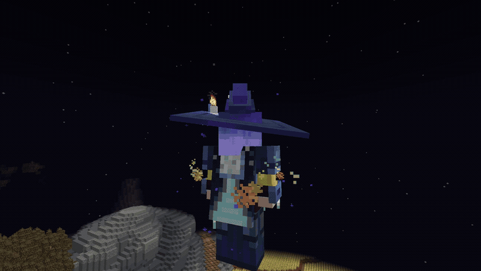
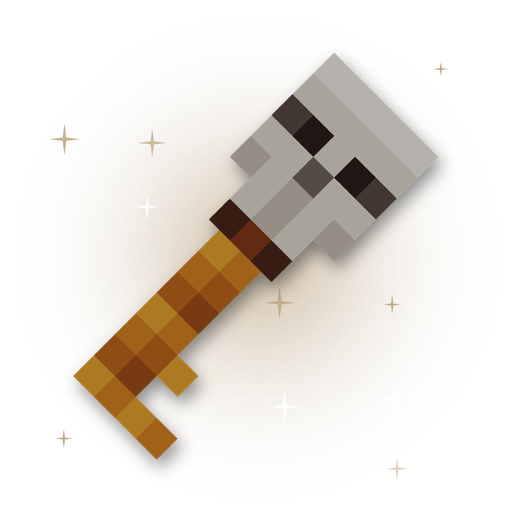
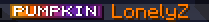
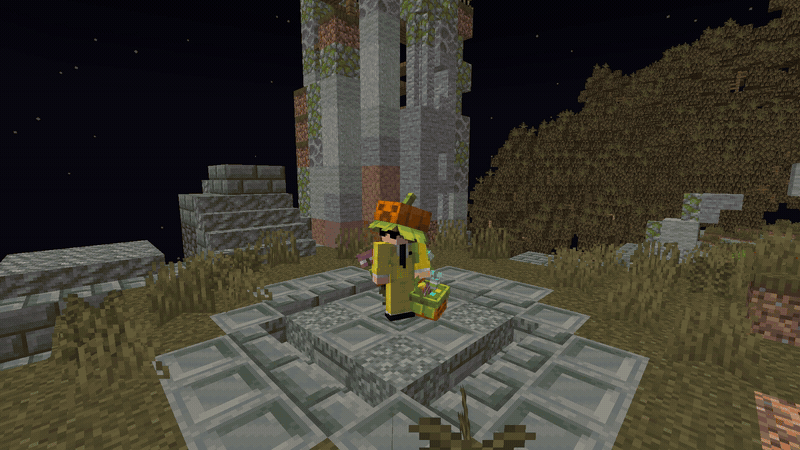

# Halloween 2026

O **Halloween 2026** foi realizado no DropMC entre **18 de outubro e 17 de novembro de 2026**, reunindo atividades especiais, uma caixa temática, cosméticos, equipamentos e itens exclusivos da temporada.

Durante a programação, os jogadores tiveram a oportunidade de conquistar **Doces**, a moeda especial do Halloween, e utilizá-los em trocas com o NPC localizado no spawn.

| Informação                | Detalhes                  |
| ------------------------- | ------------------------- |
| **Período**               | 18/10 a 17/11/2026        |
| **Moeda temática**        | Doces                     |
| **Trocas de recompensas** | NPC do Halloween no spawn |
| **Valor das trocas**      | 128 Doces por item        |

## Atividades do Halloween

### Caça aos doces

A Caça aos doces convidava os jogadores a procurar **30 doces escondidos no spawn**. Quem completava a busca recebia o **Chapéu Jack-o'-lantern**, um cosmético temático da temporada.

### Lua de sangue

A **Lua de sangue** foi uma atividade de combate em que criaturas especiais surgiam e concediam **Doces** ao serem derrotadas.

| Horários                 | Criaturas                               |
| ------------------------ | --------------------------------------- |
| **17h30, 20h30 e 00h00** | Lobisomens, demônios, bruxas e banshees |

### Palavra amaldiçoada

Na **Palavra amaldiçoada**, os jogadores acompanhavam pistas divulgadas no chat e disputavam para descobrir a palavra antes dos demais. O primeiro a acertar recebia **Doces**.

## Doces e trocas no spawn

Os **Doces** podiam ser obtidos nas atividades do Halloween ou adquiridos na [loja oficial do DropMC](https://loja.dropmc.gg/).

O **NPC do Halloween no spawn** disponibilizava recompensas em troca de Doces. **Cada item listado custava 128 Doces**, individualmente.

### Pet Ursinho de Goma

O pet cosmético temático esteve disponível nas trocas do evento por **128 Doces**.

<figure><figcaption></figcaption></figure>

### Equipamentos Cavaleiro Abóbora

O conjunto **Cavaleiro Abóbora** reuniu armaduras, armas e ferramentas com a identidade visual do Halloween. Os jogadores podiam trocar **doces por cada peça ou item**, individualmente, no NPC do evento no spawn.

#### Armadura Cavaleiro Abóbora

A armadura é composta por **elmo, peitoral, calças e botas**.

<figure><figcaption>
Armadura Cavaleiro Abóbora
</figcaption></figure>

#### Ferramentas do Cavaleiro Abóbora

As ferramentas temáticas incluíam **picareta, machado, pá e enxada**, com visuais próprios da temporada.

<figure><figcaption></figcaption></figure>

### Chave Halloween

Também era possível trocar **128 Doces por uma Chave Halloween**, utilizada para abrir a caixa temática.

<figure><figcaption></figcaption></figure>

## Caixa Halloween

A **Caixa Halloween** reuniu equipamentos da temporada e também podia conceder **Doces**.

### Armadura Praga

O conjunto Praga é composto por:

* Máscara
* Peitoral
* Calças
* Botas

<figure><figcaption></figcaption></figure>

### Itens Espectrais

Entre os itens Espectrais disponibilizados na caixa estavam **picareta, foice (espada), lança, pá, machado, enxada, clava e escudo**.

<figure><figcaption></figcaption></figure>

## VIP Halloween

A temporada também trouxe o **VIP Halloween**, um plano temático **equivalente ao MVP**.

O VIP Halloween contou com **tag e medalha exclusivas de Halloween**, com identidade visual própria do evento.

<figure><figcaption></figcaption></figure>

## Tag Pumpkin

Além do VIP Halloween, o evento disponibilizou a **tag Pumpkin** e a **medalha Pumpkin**.

<figure><figcaption></figcaption></figure>

## Cosméticos do Halloween

O Halloween também trouxe itens visuais temáticos, incluindo:

* **Conjunto Feitiçaria**;
* **Conjunto Bruxa**;
* **Abóbora Assombrada**;
* **Conjunto Abóbora Doce:** boina, mochila e cesta;
* **Bruxa Gótica**.

### Conjunto Bruxa

<figure><figcaption></figcaption></figure>

### Abóbora Assombrada

<figure><figcaption></figcaption></figure>

### Conjunto Abóbora Doce

O conjunto incluía **boina, mochila e cesta**.

<figure><figcaption></figcaption></figure>

## Pets e itens visuais apresentados na temporada

Entre os materiais visuais do evento, também estão as apresentações do **Gato Ébano** e do **Jack-o'-lantern**.

### Gato Ébano

<figure><figcaption></figcaption></figure>

As condições de obtenção desses itens variavam conforme sua disponibilidade durante a temporada. Eles não devem ser confundidos com as **recompensas de 128 Doces** oferecidas pelo NPC, descritas anteriormente.

## Como funcionava a participação

Durante o Halloween, os jogadores podiam participar da **Caça aos doces**, da **Lua de sangue** e da **Palavra amaldiçoada** para conquistar Doces. A moeda também era disponibilizada na loja oficial.

No **NPC do Halloween no spawn**, cada recompensa podia ser resgatada por **128 Doces**, incluindo os itens Cavaleiro Abóbora, o pet Ursinho de Goma e a Chave Halloween. As chaves permitiam abrir a **Caixa Halloween** e concorrer a itens Praga, Espectrais e Doces.

A temporada também contou com VIP, tags, medalhas e cosméticos temáticos. Outras novidades do DropMC podem ser acompanhadas no [Discord oficial](https://discord.gg/dropmc).
