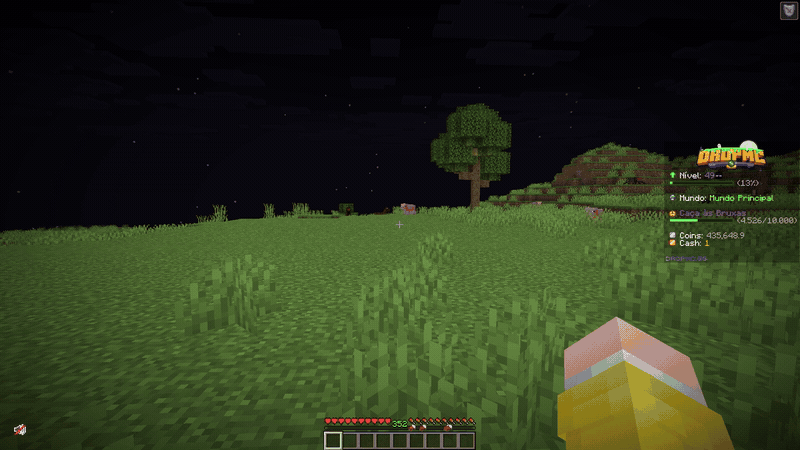

# Como proteger seu terreno

No DropMC, você pode **proteger suas construções, baús e recursos** criando um terreno com a pá de proteção. O sistema está disponível tanto no **mundo principal** quanto no **mundo de farms**.

Neste tutorial, você aprenderá a selecionar uma área, concluir a proteção e conhecer as opções de expansão e configuração.

## Criando seu primeiro terreno

### 1. Obtenha a pá de proteção

Dentro do servidor, utilize o comando `/kit terreno` para receber a pá de proteção. É com ela que você marcará os limites da área.

### 2. Escolha o local

Vá até o lugar que deseja proteger e imagine os **dois cantos opostos** da área. Eles serão usados para delimitar o terreno.

### 3. Selecione os dois pontos

Com a pá em mãos:

1. Clique com o **botão direito** em um dos pontos.
2. Clique com o **botão esquerdo** no outro ponto.

Os dois pontos definem a região que você deseja proteger.

### 4. Confirme a criação

Após selecionar a área, finalize usando **uma** das opções:

* Digite `/terreno criar` no chat.
* Pressione **F** enquanto estiver segurando a pá de proteção.

**Importante:** selecionar os pontos não conclui a proteção. É necessário confirmar a criação do terreno.

## Demonstração

<figure><figcaption></figcaption></figure>

## Como ampliar seu terreno

Se precisar de mais espaço, você poderá obter crédito de área de duas formas:

* **Papéis de Upgrade de Terreno:** disponíveis em kits VIPs. Ao usar um papel, o crédito é adicionado **à sua conta**, não a um terreno específico.
* **Loja de terrenos:** no menu de terrenos, você pode comprar créditos de área com coins em pacotes de **100, 250, 500 ou 1.000 blocos²**.

O crédito disponível é compartilhado entre seus terrenos. Quando uma área ultrapassa o limite do rank, a diferença é descontada automaticamente do crédito disponível. Se você diminuir ou excluir a área protegida, o crédito utilizado será devolvido.

## Configurações da proteção

Depois de criar o terreno, você também pode ajustar algumas opções, como:

* **Terreno público:** definir se o local será público.
* **Spawn natural de monstros:** desativar a geração natural, sem afetar spawners, ovos e ataques de aldeia.
* **Itens no chão:** impedir que jogadores sem permissão de construção recolham itens.
* **Explosões:** permitir a destruição de blocos por explosões; essa configuração vem desativada por padrão.

## Saiba mais

Para consultar os demais recursos, permissões e comandos, acesse:

* [Terrenos e proteções](../sistemas-do-servidor/terrenos-e-protecoes.md) — explicação completa do sistema.
* [Comandos de terrenos e proteções](../comandos/terrenos-e-protecoes.md) — lista de comandos disponíveis aos jogadores.

Se tiver dificuldades, procure a equipe no [Discord oficial do DropMC](https://discord.gg/dropmc).
